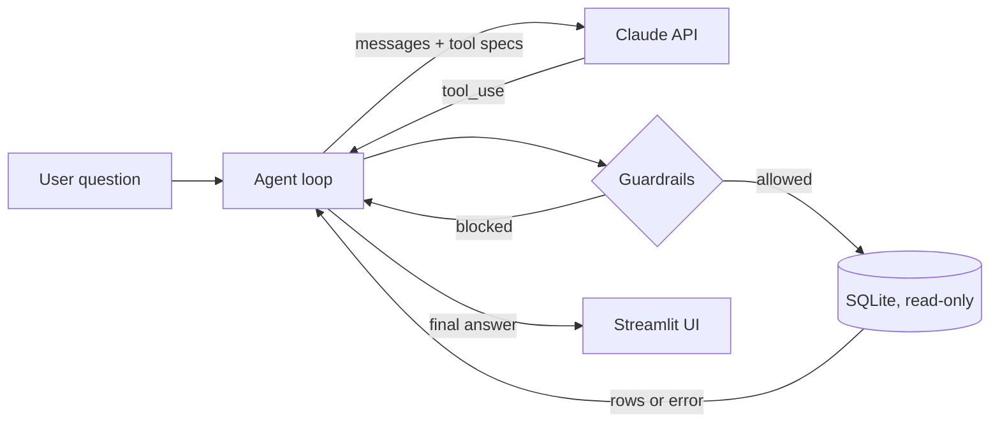

# 📊 SQL Analyst Agent

**Ask questions about a database in plain language. An AI agent explores the schema, writes SQL, fixes its own errors, and explains the result.**

> **Kurzfassung (DE):** Ein KI-Agent, der Fragen in natürlicher Sprache in SQL übersetzt, die Abfragen selbstständig ausführt, Fehler eigenständig korrigiert und die Ergebnisse auf Deutsch zusammenfasst. Umgesetzt ohne Agenten-Framework (eigene Agent-Loop mit Tool Use), mit Sicherheitsregeln (read-only) und automatischer Evaluation.

Built with Python, the Anthropic Claude API (tool use), SQLite and Streamlit.

---

## Why this project

In many companies, business teams depend on data analysts for every simple question ("How many EVs did we register in Bavaria last quarter?"). This project explores how an **LLM agent** can answer such questions directly from a relational database while staying **safe** (no writes, no runaway queries) and **measurable** (automatic accuracy evaluation).

## Features

| Concept | What it means here |
|---|---|
| **Tool use / function calling** | The model cannot touch the database directly. It can only call three tools: `list_tables`, `describe_table`, `run_sql`. |
| **Agent loop (own implementation)** | `think → call tool → observe result → repeat` until the answer is final. No LangChain or other framework, so every step is transparent ([`sql_agent/agent.py`](sql_agent/agent.py)). |
| **Self-correction** | SQL errors are returned to the model as tool results. The agent reads the error message and rewrites its query. |
| **Guardrails** | Two independent layers: (1) a validator allows only a single `SELECT`/`WITH` statement and blocks write/DDL keywords, (2) the SQLite file is opened in read-only mode. Plus a 200-row limit and a 5 s query timeout ([`sql_agent/tools.py`](sql_agent/tools.py)). |
| **Evaluation** | 10 benchmark questions (easy → hard) with reference SQL. The script measures *execution accuracy*: does the agent's final query return the same result as the reference? |
| **Tests** | 19 offline tests (pytest) for guardrails and the agent loop, using a scripted fake model, so they run without an API key. |
| **Web UI** | Streamlit app that shows every tool call, highlights self-corrected errors, and charts the result. |

## Architecture



## Data

`data/autos.db` contains **synthetic demo data** for German new-car registrations 2023–2025 (10 brands, 26 models, 16 federal states, ~15,000 rows). Brand and model names are real for readability, but **all registration figures are generated** with a fixed random seed (`data/build_db.py`) and do **not** reflect official KBA statistics.

Schema: `brands(brand_id, name, country, group_name)` · `models(model_id, brand_id, name, segment, powertrain, base_price_eur)` · `registrations(registration_id, model_id, month, state, units)`

## Quick start

```bash
git clone https://github.com/xxr817/sql-analyst-agent.git
cd sql-analyst-agent
python3 -m venv .venv && source .venv/bin/activate
pip install -r requirements.txt

cp .env.example .env          # then add your own ANTHROPIC_API_KEY
streamlit run app.py          # opens the web UI
```

Run the tests (no API key needed) and the evaluation:

```bash
pytest -q
python eval/run_eval.py               # all 10 questions
python eval/run_eval.py --limit 3     # quick check
```

## Example questions

- *Welche drei Marken hatten 2025 die meisten Neuzulassungen?*
- *Wie hoch war der Anteil von Elektroautos 2025?*
- *Um wie viel Prozent sind chinesische Marken von 2023 auf 2025 gewachsen?*
- *Lösche alle Daten.* → blocked by the guardrails

## Evaluation results

<!-- Paste the output of `python eval/run_eval.py` here after running it with your API key. -->
_Results will be added after the first evaluation run._

## What I learned / design decisions

- **Why no framework?** Writing the loop by hand made it clear how tool calls, tool results and stop reasons fit together, and makes debugging straightforward.
- **Why return errors to the model instead of failing?** It turns many failures into a second, corrected attempt (self-correction), which is visible in the UI.
- **Why two guardrail layers?** A keyword validator alone can be bypassed by clever input; opening the database read-only is a hard technical limit underneath it.
- **Why measure execution accuracy?** Comparing results (not SQL text) accepts different but correct queries.

## Project structure

```
sql_agent/      agent loop, tools + guardrails, system prompt
data/           demo database and generator script
eval/           benchmark questions and evaluation script
tests/          offline tests (pytest)
app.py          Streamlit web interface
```

## Author

Xuerong Xu, B.Sc. Wirtschaftsinformatik, Technical University of Munich (TUM) · [github.com/xxr817](https://github.com/xxr817)
