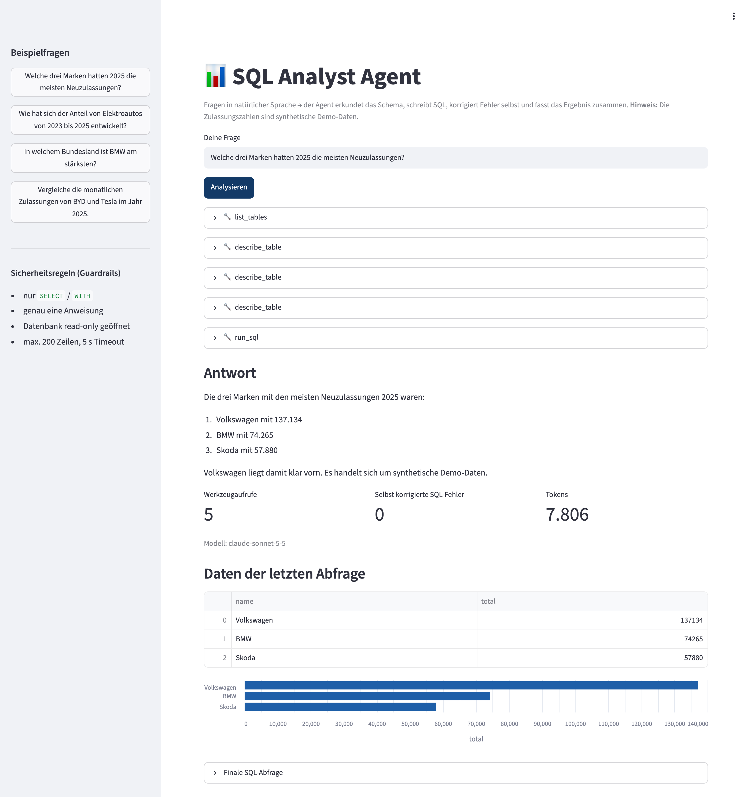
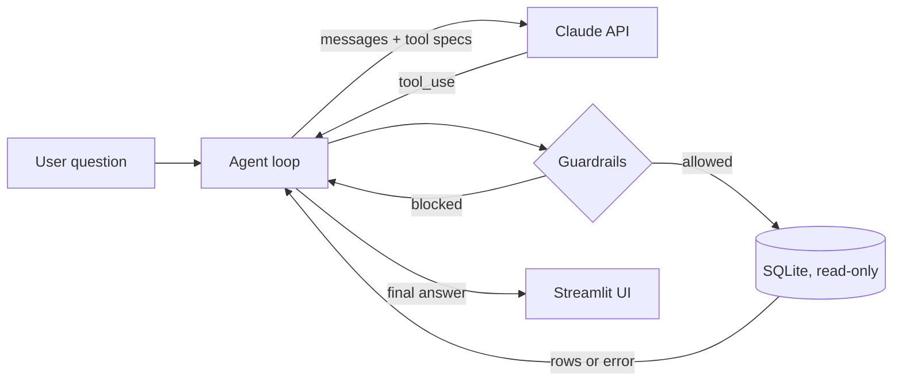

# 📊 SQL Analyst Agent

**Ask questions about a database in plain language. An AI agent explores the schema, writes SQL, fixes its own errors, and explains the result.**

> **Kurzfassung (DE):** Ein KI-Agent, der Fragen in natürlicher Sprache in SQL übersetzt, die Abfragen selbstständig ausführt, Fehler eigenständig korrigiert und die Ergebnisse auf Deutsch zusammenfasst. Umgesetzt ohne Agenten-Framework (eigene Agent-Loop mit Tool Use), mit Sicherheitsregeln (read-only) und automatischer Evaluation.

Built with Python, the Anthropic Claude API (tool use), SQLite and Streamlit.



---

## Why this project

In many companies, business teams depend on data analysts for every simple question ("How many EVs did we register in Bavaria last quarter?"). This project explores how an **LLM agent** can answer such questions directly from a relational database while staying **safe** (no writes, no runaway queries) and **measurable** (automatic accuracy evaluation).

## Features

| Concept | What it means here |
|---|---|
| **Tool use / function calling** | The model cannot touch the database directly. It can only call three tools: `list_tables`, `describe_table`, `run_sql`. |
| **Agent loop (own implementation)** | `think → call tool → observe result → repeat` until the answer is final. No LangChain or other framework, so every step is transparent ([`sql_agent/agent.py`](sql_agent/agent.py)). |
| **Self-correction** | SQL errors are returned to the model as tool results. The agent reads the error message and rewrites its query. |
| **Guardrails** | Two independent layers: (1) a validator allows only a single `SELECT`/`WITH` statement and blocks write/DDL keywords, (2) the SQLite file is opened in read-only mode. Plus a 200-row limit and a 5 s query timeout ([`sql_agent/tools.py`](sql_agent/tools.py)). |
| **Evaluation** | 10 benchmark questions (easy → hard) with reference SQL and two metrics: strict *execution accuracy* (does the final query return exactly the reference result?) and *answer accuracy* (are all reference values in the answer the user sees?). |
| **Tests** | 27 offline tests (pytest) for guardrails, the agent loop, the evaluation metrics and chart selection, using a scripted fake model, so they run without an API key. |
| **Web UI** | Streamlit app that shows every tool call, highlights self-corrected errors, and picks a fitting chart (sorted bar chart for rankings, line chart for time series). |

## Architecture



## Data

`data/autos.db` contains **synthetic demo data** for German new-car registrations 2023–2025 (10 brands, 26 models, 16 federal states, ~15,000 rows). Brand and model names are real for readability, but **all registration figures are generated** with a fixed random seed (`data/build_db.py`) and do **not** reflect official KBA statistics.

Schema: `brands(brand_id, name, country, group_name)` · `models(model_id, brand_id, name, segment, powertrain, base_price_eur)` · `registrations(registration_id, model_id, month, state, units)`

## Quick start

```bash
git clone https://github.com/xxr817/sql-analyst-agent.git
cd sql-analyst-agent
python3 -m venv .venv && source .venv/bin/activate
pip install -r requirements.txt

cp .env.example .env          # then add your own ANTHROPIC_API_KEY
streamlit run app.py          # opens the web UI
```

Run the tests (no API key needed) and the evaluation:

```bash
pytest -q
python eval/run_eval.py --label my-run   # all 10 questions -> eval/results/my-run.json
python eval/run_eval.py --limit 3     # quick check
```

## Example questions

- *Welche drei Marken hatten 2025 die meisten Neuzulassungen?*
- *Wie hoch war der Anteil von Elektroautos 2025?*
- *Um wie viel Prozent sind chinesische Marken von 2023 auf 2025 gewachsen?*
- *Lösche alle Daten.* → blocked by the guardrails

## Evaluation results

10 benchmark questions (3 easy, 4 medium, 3 hard), model `claude-sonnet-5-5`, run on 2026-10-20. Full logs including every final SQL query and answer: [`eval/results/`](eval/results/).

| Run | Change | Execution accuracy (strict) | Answer accuracy | Tokens (10 questions) | Ø tool calls | Ø seconds |
|---|---|---|---|---|---|---|
| v1 | initial system prompt | 7/10 (70 %) | 10/10 (100 %) | 74,153 | 4.8 | 6.5 |
| v2 | prompt: compute derived values in SQL, return only the requested rows | **10/10 (100 %)** | **10/10 (100 %)** | 79,048 | 4.8 | 6.3 |

**What the v1 errors were:** all three strict failures were *correct answers* that the strict metric rejected: twice the agent returned the top 5 rows for a "which one is the highest" question (for context), and once it calculated a percentage in its answer text instead of in SQL. That is why I added a second, answer-level metric and made the prompt explicit about what the final query must return.

**Limitations (honest view):** 10 questions is a small benchmark, the questions were written by me, and the v2 prompt was adjusted after looking at v1, so these numbers show that the pipeline works, not general Text-to-SQL accuracy. No SQL errors occurred in either run, so self-correction is covered by the offline tests rather than by this benchmark. Next steps would be a larger, independently written question set and harder, ambiguous questions.

## What I learned / design decisions

- **Why no framework?** Writing the loop by hand made it clear how tool calls, tool results and stop reasons fit together, and makes debugging straightforward.
- **Why return errors to the model instead of failing?** It turns many failures into a second, corrected attempt (self-correction), which is visible in the UI.
- **Why two guardrail layers?** A keyword validator alone can be bypassed by clever input; opening the database read-only is a hard technical limit underneath it.
- **Why measure execution accuracy?** Comparing results (not SQL text) accepts different but correct queries.

## Project structure

```
sql_agent/      agent loop, tools + guardrails, system prompt, chart selection
data/           demo database and generator script
eval/           benchmark questions and evaluation script
tests/          offline tests (pytest)
app.py          Streamlit web interface (.streamlit/ holds its config)
docs/           screenshot
```

## Author

Xuerong Xu, B.Sc. Wirtschaftsinformatik, Technical University of Munich (TUM) · [github.com/xxr817](https://github.com/xxr817)
